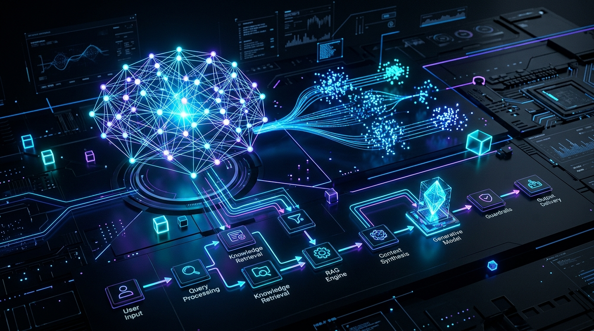
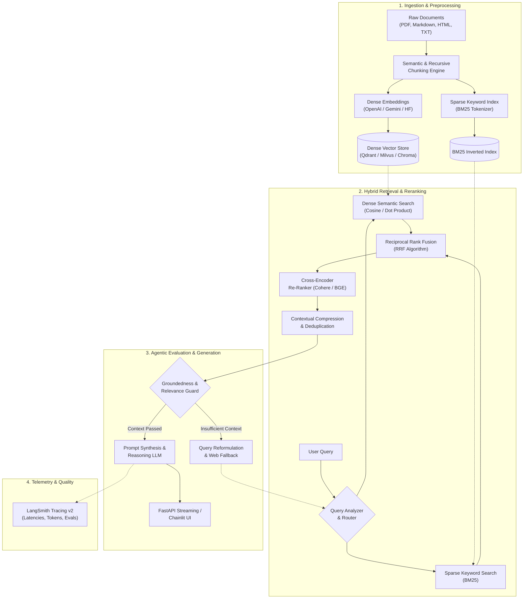
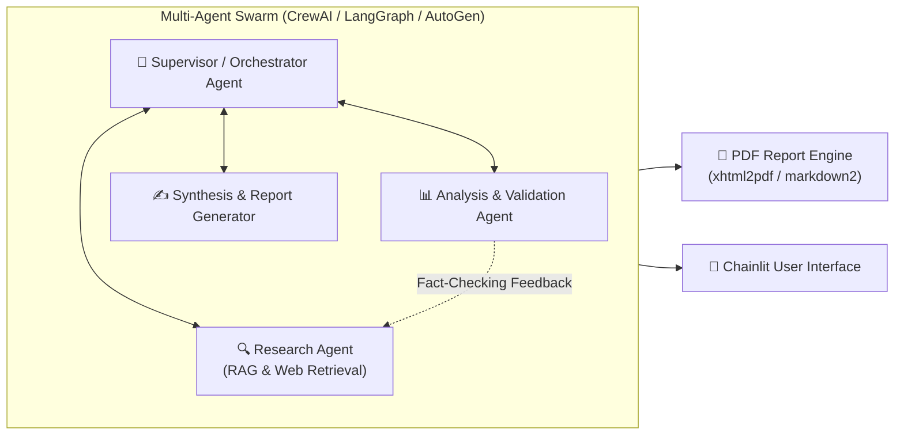

<div align="center">



<br/><br/>

# ⚡ Advanced RAG: Build & Deploy Production GenAI Apps

<p align="center">
  <strong>Enterprise-Grade Retrieval-Augmented Generation, Multi-Agent Orchestration & Production LLM Deployment</strong>
</p>

<p align="center">
  <a href="#-key-features"></a>
  <a href="#-tech-stack"></a>
  <a href="#-tech-stack"></a>
  <a href="#-tech-stack"></a>
  <a href="#-tech-stack"></a>
  <a href="#-tech-stack"></a>
  <a href="#-observability--evaluation"></a>
  <a href="LICENSE"></a>
</p>

<p align="center">
  <a href="#-overview">Overview</a> •
  <a href="#-system-architecture">System Architecture</a> •
  <a href="#-key-features">Key Features</a> •
  <a href="#-project-structure">Project Structure</a> •
  <a href="#-quick-start">Quick Start</a> •
  <a href="#-configuration">Configuration</a> •
  <a href="#-observability--evaluation">Observability</a> •
  <a href="#-license">License</a>
</p>

---

</div>

## 📌 Overview

Most tutorials demonstrate "Toy RAG"—naive vector search with top-k cosine similarity that degrades severely in production due to chunk fragmentation, hallucinated citations, missing context, and latency bottlenecks.

**Advanced RAG: Build & Deploy Production GenAI Apps** bridges the gap between proof-of-concept prototypes and enterprise-ready, scalable AI solutions. This repository provides end-to-end architectures, hybrid retrieval algorithms, multi-agent conversational patterns, and production-hardened microservices ready for deployment.

### 🎯 Key Engineering Goals

- **Zero-Loss Context Retrieval**: Hybrid dense + sparse search (BM25 + vector embeddings) fused via Reciprocal Rank Fusion (RRF).
- **Self-Reflective & Corrective Flows**: Query reformulation, context validation, and self-correction loops before final response generation.
- **Multi-Agent Orchestration**: Collaborative reasoning pipelines leveraging LangGraph, CrewAI, and Microsoft AutoGen.
- **Provider Agnostic**: Unified interfaces for OpenAI (GPT-4o), Google Gemini, Groq (Llama-3), and local offline inference via Ollama and HuggingFace.
- **Production Observability**: Full lifecycle tracing, latency profiling, and automated evaluation metrics via LangSmith Tracing V2.
- **Full-Stack Delivery**: Async FastAPI REST APIs coupled with interactive Chainlit chat frontends and automated PDF/Markdown reporting.

---

## 🏗️ System Architecture

### 1. Advanced End-to-End RAG Pipeline



---

### 2. Multi-Agent Collaborative Architecture



---

## 🌟 Key Features

| Capability | Naive RAG | This Repository (Advanced Production RAG) |
| :--- | :--- | :--- |
| **Indexing Strategy** | Fixed chunk size (e.g. 500 chars) | Hierarchical, recursive, & semantic boundaries preserving context integrity |
| **Search Paradigm** | Dense cosine similarity only | **Hybrid Search**: Dense Vector + BM25 Sparse Keyword Retrieval |
| **Fusion Mechanism** | Top-K similarity cutoff | **Reciprocal Rank Fusion (RRF)** + Cross-Encoder Re-ranking |
| **Query Handling** | Raw user prompt as query | HyDE (Hypothetical Document Embeddings) & Multi-Query decomposition |
| **Agentic Loops** | Single-turn feedforward pass | Stateful cyclic graphs (**LangGraph**), multi-agent teams (**CrewAI**, **AutoGen**) |
| **Model Portability** | Hardcoded to single provider | Swappable interfaces: **OpenAI**, **Google Gemini**, **Groq**, **Ollama**, **Transformers** |
| **Observability** | Console print statements | Enterprise distributed tracing, latency breakdowns, and token costs via **LangSmith** |
| **Serving & UI** | Standalone Jupyter Notebook | Scalable **FastAPI** async API endpoints + real-time streaming **Chainlit** UI |

---

## 📂 Project Structure

```bash
Advanced-RAG-Build---Deploy-Production-GenAI-Apps/
│
├── .env.example              # Template for API keys, models, and endpoints
├── .gitignore                # Comprehensive Git ignore rules
├── requirements.txt          # Python ecosystem dependencies
├── README.md                 # Project technical documentation
│
├── api/                      # FastAPI asynchronous application
│   ├── main.py               # Application entrypoint & CORS configuration
│   ├── routes/               # API routes (query, streaming, file upload, health)
│   └── schemas/              # Pydantic v2 validation models
│
├── agents/                   # Multi-agent workflows & team definitions
│   ├── crew/                 # CrewAI agent roles, tasks, and crews
│   ├── graph/                # LangGraph stateful cyclic graphs & nodes
│   └── autogen/              # AutoGen conversational patterns
│
├── core/                     # Foundational RAG & LLM logic
│   ├── config.py             # App settings loaded via pydantic-settings
│   ├── embeddings.py         # Multi-provider vector embedding factory
│   ├── llm_factory.py        # Dynamic LLM provider loader (OpenAI, Gemini, Groq, Ollama)
│   └── prompts.py            # System prompts, few-shot examples, and templates
│
├── indexing/                 # Data preparation & document ingestion
│   ├── chunkers.py           # Recursive, semantic, and markdown chunking
│   ├── loaders.py            # PDF, text, markdown, and web loaders
│   └── vector_store.py       # Vector store abstractions & hybrid indexers
│
├── retrieval/                # Advanced retrieval mechanics
│   ├── bm25.py               # Sparse keyword search engine
│   ├── hybrid.py             # Hybrid search with Reciprocal Rank Fusion (RRF)
│   ├── rerankers.py          # Cross-encoder re-ranking pipelines
│   └── self_reflection.py    # Corrective RAG (CRAG) & guardrails
│
├── ui/                       # Frontend conversational interface
│   ├── app.py                # Chainlit application with streaming responses
│   └── chainlit.md           # Chainlit homepage styling & welcome prompt
│
└── utils/                    # Exporters, formatters, and database helpers
    ├── db.py                 # SQLite / SQLAlchemy async session manager
    └── pdf_exporter.py       # Markdown to PDF export engine (xhtml2pdf)
```

---

## 🛠️ Tech Stack

<div align="center">

| Layer | Technologies |
| :--- | :--- |
| **Core Framework** | Python 3.10+, [FastAPI](https://fastapi.tiangolo.com/), [Pydantic](https://docs.pydantic.dev/) |
| **RAG & Orchestration** | [LangChain](https://www.langchain.com/), [LangGraph](https://langchain-ai.github.io/langgraph/), `ragwire` |
| **Agentic Intelligence** | [CrewAI](https://crewai.com/), [Microsoft AutoGen](https://microsoft.github.io/autogen/), `agent-framework` |
| **LLM Providers** | OpenAI (GPT-4o), Google Gemini 1.5/2.0, Groq (Llama-3), Ollama, HuggingFace Transformers |
| **Retrieval & Reranking** | Dense Embeddings, BM25 Keyword Search, Reciprocal Rank Fusion, Cross-Encoders |
| **Observability & Evals** | [LangSmith](https://smith.langchain.com/) (Distributed Tracing, Latency & Hallucination Tracking) |
| **Frontend & Chat UI** | [Chainlit](https://chainlit.io/), Markdown2, XHTML2PDF |
| **Database & Persistence**| SQLAlchemy, aiosqlite |

</div>

---

## 🚀 Quick Start

### 1. Prerequisites
- Python 3.10 or higher
- Git
- Virtual environment tool (`venv`, `conda`, or `uv`)

### 2. Clone Repository
```bash
git clone https://github.com/udityamerit/Advanced-RAG-Build---Deploy-Production-GenAI-Apps.git
cd "Advanced-RAG-Build---Deploy-Production-GenAI-Apps"
```

### 3. Setup Virtual Environment
```bash
# Using standard venv
python -m venv .venv

# Activate on Windows (PowerShell)
.venv\Scripts\Activate.ps1

# Activate on Linux / macOS
source .venv/bin/activate
```

### 4. Install Dependencies
```bash
pip install --upgrade pip
pip install -r requirements.txt
```

---

## ⚙️ Configuration

Copy the sample environment file to `.env`:

```bash
cp .env.example .env
```

Edit `.env` with your active API keys:

```dotenv
# --- Observability (LangSmith) ---
LANGSMITH_API_KEY="your-langsmith-key"
LANGSMITH_PROJECT="ProductionGradeRAG"
LANGSMITH_ENDPOINT="https://api.smith.langchain.com"
LANGCHAIN_TRACING_V2=true

# --- LLM Providers (Configure at least one) ---
OPENAI_API_KEY="sk-..."
GOOGLE_API_KEY="AIzaSy..."
GROQ_API_KEY="gsk_..."

# --- Local Inference (Optional) ---
# OLLAMA_BASE_URL="http://localhost:11434"

# --- Database & Settings ---
DATABASE_URL="sqlite+aiosqlite:///./production_rag.db"
APP_ENV="development"
LOG_LEVEL="INFO"
```

---

## 🖥️ Running the Application

### Option A: Launch Interactive Chainlit Chat UI
Run the interactive conversational frontend featuring real-time token streaming, session history, and multi-modal document upload:

```bash
chainlit run ui/app.py -w
```
> Open your browser at `http://localhost:8000` to interact with the system.

### Option B: Launch FastAPI Backend Server
Start the high-performance asynchronous REST microservice:

```bash
uvicorn api.main:app --host 0.0.0.0 --port 8000 --reload
```
> Access interactive Swagger API documentation at `http://localhost:8000/docs`.

---

## 🔍 Observability & Evaluation

This repository includes native hooks for **LangSmith Tracing v2**. Every document ingestion, retriever query, cross-encoder step, agent decision, and LLM call is automatically captured and structured.

```
┌────────────────────────────────────────────────────────────┐
│                    LangSmith Dashboard                     │
├────────────────────────────┬─────────────┬─────────────────┤
│ Run Name                   │ Latency     │ Status          │
├────────────────────────────┼─────────────┼─────────────────┤
│ ├── HybridRetriever        │ 42ms        │ ✅ Success      │
│ │   ├── BM25_Query         │ 8ms         │ ✅ Success      │
│ │   └── Vector_Cosine      │ 34ms        │ ✅ Success      │
│ ├── CrossEncoder_Rerank    │ 65ms        │ ✅ Success      │
│ ├── SelfReflection_Check   │ 110ms       │ ✅ Verified     │
│ └── Generation_Llama3_70B  │ 420ms       │ ✅ Streamed     │
└────────────────────────────┴─────────────┴─────────────────┘
```

### Evaluation Metrics
- **Context Precision**: Ratio of relevant retrieved chunks to total retrieved chunks.
- **Context Recall**: Presence of necessary ground-truth facts in the retrieved context.
- **Faithfulness / Groundedness**: Verification that the generated answer is derived strictly from retrieved context without hallucinations.
- **Answer Relevance**: Semantic similarity between the user's intent and final output.

---

## 🤝 Contributing

Contributions, issues, and feature requests are welcome!
1. Fork the Project
2. Create your Feature Branch (`git checkout -b feature/AmazingFeature`)
3. Commit your Changes (`git commit -m 'Add some AmazingFeature'`)
4. Push to the Branch (`git push origin feature/AmazingFeature`)
5. Open a Pull Request

---

## 📄 License

Distributed under the MIT License. See [LICENSE](LICENSE) for more information.

---

## 👤 Author & Acknowledgements

- **Author**: Uditya Narayan Tiwari ([@udityamerit](https://github.com/udityamerit))
- **Course Inspiration**: *Advanced RAG: Build & Deploy Production GenAI Apps*

<div align="center">
  <sub>Built with ❤️ for AI Engineers & GenAI Practitioners. If you found this useful, please consider giving it a ⭐!</sub>
</div>
